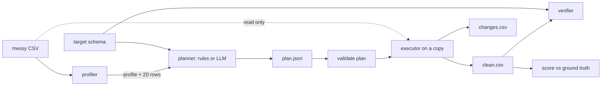

# csvmend

[](https://github.com/shreyas-tech7/csvmend/actions/workflows/ci.yml)

**Status:** release candidate v0.1.0-rc1. The rule baseline is measured on generated data with ground truth. The LLM planner is built and tested with replayed answers, but no real model run exists yet, because the build machine could not reach a free provider.

## The problem

Small businesses run on spreadsheets that come from several systems. One export writes dates as 03/14/2025, another as 14.03.2025. Prices show up as $1,234.50 or 1.234,50. Weights mix kilograms and pounds. Names arrive as garbled bytes, categories carry typos, and the same customer appears twice with a small change.

You can ask an LLM to fix the file. Then you have to trust code you did not read, run on data you cannot check. csvmend splits the job. A planner writes a short plan in a small JSON language. Plain code checks the plan, runs it on a copy, logs every changed cell and verifies the output against your schema. A seeded generator makes messy files with known clean answers, so the accuracy of each planner is a number with an interval.

## How it works



1. The profiler summarizes each column: kinds of values, shapes such as `99/99/9999`, null words, top values for low cardinality columns and three examples from a fixed sample.
2. A planner reads the profile and your schema and writes a plan. The LLM planner sees the profile and at most 20 rows, never the whole file.
3. The plan language has 12 operations: `parse_dates`, `normalize_currency`, `map_values`, `fuzzy_dedupe`, `split_column`, `merge_columns`, `convert_units`, `trim`, `fill_missing`, `drop_rows`, `cast` and `rename`. Each one checks its own arguments. The validator also follows the header through the plan, so a step that names a missing column fails before any row changes.
4. The executor opens the input read only and writes `clean.csv`, `plan.json`, `changes.csv` and `run.json` to a new folder. Every change goes through five logged primitives, so replaying `changes.csv` on the input rebuilds `clean.csv` byte for byte.
5. The verifier checks columns, types, ranges, allowed values, the unique key and how many rows were dropped.
6. In benchmark runs, the score compares the output with the clean table the generator kept.

## Results

<!-- gen:results -->
Held out sets (24 datasets, generator seeds 1000 to 1023, new mixes of four to six messes). Run on 2026-11-21. Bootstrap: 2000 resamples over datasets, seed 0. The rule baseline is deterministic. LLM model: none recorded (see Limits).

| Mess type | Datasets | Cell accuracy, rules | Row recall, rules | Duplicate F1, rules | Cell accuracy, no plan |
| --- | --- | --- | --- | --- | --- |
| all cells | 24 | 99.8% (99.7 to 99.9) | 94.4% (92.3 to 96.5) | 89.1% (86.4 to 91.6) | 55.8% (48.4 to 63.3) |
| mixed dates | 17 | 100.0% (100.0 to 100.0) | 94.4% (91.9 to 96.8) |  | 0.0% (0.0 to 0.0) |
| currency | 12 | 100.0% (100.0 to 100.0) | 94.6% (91.8 to 97.5) |  | 0.0% (0.0 to 0.0) |
| category typos | 12 | 100.0% (100.0 to 100.0) | 96.4% (93.5 to 98.8) |  | 0.3% (0.0 to 0.7) |
| near duplicates | 15 | n/a | 99.1% (98.1 to 100.0) | 89.2% (86.5 to 91.8) | n/a |
| unit mismatch | 9 | 100.0% (100.0 to 100.0) | 96.6% (93.5 to 99.3) |  | 0.0% (0.0 to 0.0) |
| split merge | 13 | 98.8% (98.1 to 99.5) | 94.9% (92.1 to 97.7) |  | 0.0% (0.0 to 0.0) |
| whitespace encoding | 16 | 99.7% (99.4 to 99.9) | 96.0% (93.1 to 98.5) |  | 13.2% (8.7 to 17.8) |
| missing values | 11 | 100.0% (100.0 to 100.0) | 94.9% (91.9 to 97.8) |  | 13.4% (8.8 to 18.8) |
| shifted rows | 13 | n/a | 18.5% (10.3 to 25.6) |  | 35.6% (27.9 to 42.3) |

The verifier passed every check on 16 of 24 held out outputs. Failed checks by name: row_count 8. The row_count check flags outputs that lost more than a fifth of their rows.

Second held out run with new seeds (2000 to 2023), because the first looked very good: cell accuracy 99.9% (99.8 to 100.0), row recall 94.2% (91.8 to 96.6), duplicate F1 91.3% (85.4 to 95.8).
<!-- /gen:results -->

Cell accuracy counts cells in rows that reached the output. Row recall counts clean rows that reached the output. The near duplicates row has no cell accuracy, because that mess adds rows instead of changing cells. Shifted rows have no cell accuracy either, because the plan drops them.

<details>
<summary>Development sets</summary>

<!-- gen:dev -->
Development sets (40 datasets, seeds 0 to 39, three messes each). The rules were tuned on these, so expect them to look better than the held out sets.

| Mess type | Datasets | Cell accuracy, rules | Row recall, rules | Duplicate F1, rules | Cell accuracy, no plan |
| --- | --- | --- | --- | --- | --- |
| all cells | 40 | 100.0% (100.0 to 100.0) | 95.7% (94.0 to 97.2) | 94.5% (90.8 to 96.7) | 72.8% (68.4 to 77.1) |
| mixed dates | 8 | 100.0% (100.0 to 100.0) | 94.3% (88.1 to 100.0) |  | 0.0% (0.0 to 0.0) |
| currency | 9 | 100.0% (100.0 to 100.0) | 97.2% (94.3 to 99.6) |  | 0.0% (0.0 to 0.0) |
| category typos | 13 | 100.0% (100.0 to 100.0) | 95.2% (91.6 to 98.5) |  | 0.2% (0.0 to 0.6) |
| near duplicates | 14 | n/a | 99.5% (98.3 to 100.0) | 96.5% (94.2 to 98.2) | n/a |
| unit mismatch | 7 | 100.0% (100.0 to 100.0) | 95.4% (90.5 to 99.7) |  | 0.0% (0.0 to 0.0) |
| split merge | 13 | 100.0% (100.0 to 100.0) | 96.9% (94.6 to 98.8) |  | 0.0% (0.0 to 0.0) |
| whitespace encoding | 13 | 99.9% (99.7 to 100.0) | 96.1% (93.0 to 99.0) |  | 16.9% (12.7 to 21.3) |
| missing values | 21 | 100.0% (100.0 to 100.0) | 94.9% (91.7 to 97.7) |  | 13.6% (10.2 to 17.4) |
| shifted rows | 17 | n/a | 0.7% (0.0 to 2.0) |  | 37.7% (33.1 to 42.3) |
<!-- /gen:dev -->

</details>

## Cost per task

<!-- gen:cost -->
| Planner | Money | Time per dataset | Operations per plan | Model calls |
| --- | --- | --- | --- | --- |
| rule baseline | 0 dollars | 156 ms (profile, plan, run, verify) | 6.5 | 0 |
| LLM planner | 0 dollars on a free tier | not measured | not measured | 1 per dataset, about 1830 prompt tokens |

Times come from Intel(R) Xeon(R) Processor @ 2.10GHz, 1 core used, Python 3.13.18, 2026-11-21. Token counts are characters divided by four, an estimate.
<!-- /gen:cost -->

## Run it in 10 minutes

You need Python 3.11 or newer and git. uv is optional.

```bash
git clone https://github.com/shreyas-tech7/csvmend.git
cd csvmend
./init.sh                      # makes .venv, installs, lints, runs every test offline
source .venv/bin/activate

csvmend demo                   # one small messy table, its plan and the clean result

csvmend generate --kind orders --seed 3 --out data --name orders
csvmend profile data/orders.csv | head -40
csvmend plan data/orders.csv --schema orders -o plan.json
csvmend run data/orders.csv --plan plan.json --out out
csvmend verify out/clean.csv --schema orders
csvmend replay data/orders.csv --log out/changes.csv | diff - out/clean.csv && echo replay matches

csvmend bench                  # every dataset in the suite, writes results/bench.json
csvmend readme                 # rewrites the README tables from the results files
```

To clean your own file, write a schema JSON like `data/orders.schema.json` and pass its path to `--schema`. Read `plan.json` before you run it. Open `docs/index.html` in a browser for the before and after view.

## Limits

- All data is synthetic, and the rule baseline was written by the same person who wrote the generator. Its high scores show that the rules cover these messes, not that they cover yours. The held out sets use new seeds and new mixes, but the same kinds of mess.
- No LLM result exists yet. The provider hosts were unreachable from the build machine. The record command is in docs/HUMAN_STEPS.md.
- Rows with a stray extra field are dropped, not repaired. None of the 12 operations can shift a row back, so row recall for that mess is low.
- fuzzy_dedupe compares rows inside a block keyed on the first two letters of one column. A typo there hides the pair. It also merges a few distinct rows that look alike.
- The verifier cannot tell a wrong value of the right type from a right one. A date parsed as March 4 instead of April 3 passes every check.
- Lost values stay empty. csvmend never guesses a value.
- The CSV must fit in memory. No databases, Excel formulas, user interface or joins.

## Glossary

- **Plan:** a JSON list of steps. Data, not code.
- **Profile:** a short summary of each column, with no whole file inside.
- **Ground truth:** the clean table the generator started from.
- **Cell accuracy:** the share of output cells that match the clean value.
- **Row recall:** the share of clean rows that reach the output.
- **Duplicate F1:** how well the dedupe step finds the injected copies, from precision and recall over row pairs.
- **95% interval:** a bootstrap range. Resampling the datasets 2000 times, 95% of the results fall inside it.
- **Held out set:** datasets with seeds and mess mixes that the rules never saw during tuning.

## Related work

- CleanAgent (https://arxiv.org/abs/2403.08291) pairs an LLM with a declarative cleaning library and shows that short API calls beat long generated code for standardization.
- OpenRefine (https://openrefine.org) is an interactive tool that records the operations a person applies and can replay them.
- csvmend adds a public benchmark with ground truth for each mess type, and plans that a person can read and approve before anything runs.

## How this was built

AI agents wrote most of the code under Shreyas's direction. The full build prompt is in [docs/build/BUILD_PROMPT.md](docs/build/BUILD_PROMPT.md). Choices and their reasons are in [DECISIONS.md](DECISIONS.md), and failures are in [BLOCKERS.md](BLOCKERS.md).

Human checks, not done yet:

- Shreyas reads the plan language and the change log format.
- Shreyas runs csvmend on one real export of his own.
- Shreyas reviews the benchmark design for leaks between the generator and the rules.

License: MIT.
